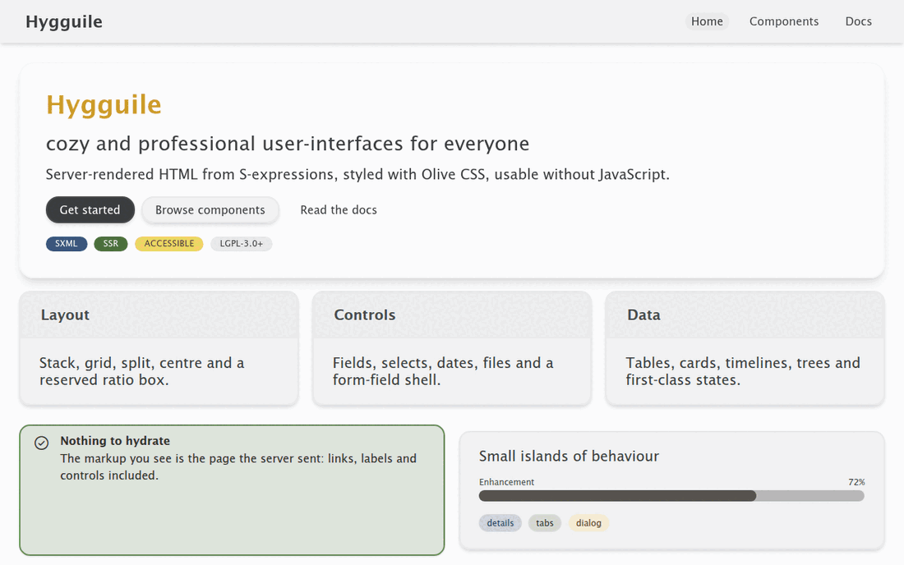

#+title: Hygguile
#+subtitle: Cozy, accessible, server-rendered user interfaces from S-expressions
#+author: Josep Bigorra
#+email: jjbigorra@gmail.com
#+options: toc:nil
#+language: en

[[https://jointhefreeworld.org/ggg/dist/scheme-guile.svg]] [[https://jointhefreeworld.org/ggg/dist/gnu-guix.svg]] [[https://img.shields.io/badge/Guile-3.0%2B-4e5d94.svg]] [[https://img.shields.io/badge/Guix-package-6f4e9c.svg]]
[[https://jointhefreeworld.org/ggg/dist/license-lgpl3+.svg]] [[https://jointhefreeworld.org/ggg/dist/license-fdl13+.svg]]

#+begin_quote
*Cozy and professional user-interfaces for everyone.*
#+end_quote

Hygguile is a **batteries-included UI framework for Guile Scheme**. You write pages as S-expressions (SXML); Hygguile renders complete, accessible HTML on the server and enhances it in the browser only where that helps. It is built on [[https://codeberg.org/jjba23/olive-css][Olive CSS]] and ships the components, design tokens, styles and small progressive-enhancement scripts you need to build a real interface.

**If you want server-rendered web UIs in Guile Scheme -- HTML that works without JavaScript and looks good out of the box -- Hygguile is for you.**

New here? Jump to [[#quickstart][Quickstart]], browse the [[https://hygguile.jointhefreeworld.org/][showcase]], or [[https://codeberg.org/jjba23/hygguile/issues][open an issue]] with a question. There are no silly questions, and every contribution -- a typo fix, a bug report, a component idea -- is welcome.

#+attr_html: :width 100%
#+caption: The deployed [[https://hygguile.jointhefreeworld.org/][showcase]], in both themes: the type scale, a card and a container beside it, the palette, and a data table.

* Features
:PROPERTIES:
:CUSTOM_ID: features
:END:

- **An expressive DSL.** Components are ordinary Scheme procedures named after the HTML they produce: ~(input #:label "Email" #:name "email")~, ~(table ...)~, ~(details ...)~.
- **Server-side rendering by default.** No hydration, no client-side router, no framework bundle before the first pixel.
- **Accessible, native HTML.** Real ~<label for>~, ~<caption>~, ~<th scope>~, ~
~, focus management and a WCAG AA contrast gate.
- **Batteries included.** Layout primitives, form fields and a FormField abstraction, overlays, navigation, data display, loading/empty/error states, tokens, dark mode and density modes.
- **Olive CSS underneath.** Utility classes you can read, plus a small companion stylesheet for the pieces that need structure.
- **Works without JavaScript.** Links navigate, forms submit, disclosures open, drawers and palettes open from the URL; scripts only make things nicer.

* Contents
:PROPERTIES:
:CUSTOM_ID: contents
:END:

- [[#features][Features]]
- [[#why-hygguile][Why Hygguile?]]
- [[#quickstart][Quickstart]]
- [[#ways-to-install][Ways to install]]
- [[#installation][Installation]]
- [[#how-components-look-like][How components look]]
- [[#configuration][Configuration]]
- [[#component-index][Component index]]
- [[#feature-completeness][Feature completeness]]
- [[#guides][Guides]]
- [[#theming-dark-mode-and-contrast][Theming, dark mode and contrast]]
- [[#development-and-contributing][Development and contributing]]
- [[#community-and-project][Community and project]]
- [[#design-notes][Design notes]]
- [[#license][License]]

* Why Hygguile?
:PROPERTIES:
:CUSTOM_ID: why-hygguile
:END:

Hygguile is opinionated, but not in the way that hides the web from you. It is opinionated about **cozy, professional defaults**: readable type, generous spacing, honest semantics, and a colour system that stays legible in both themes. It is *not* opinionated about your application: there is no client-side state to adopt, no build step that must agree with the server, and no second source of truth.

The project is also a statement about server rendering. Most software we ship -- content sites, forms, dashboards, admin panels -- does not need a client-side application framework. It needs a document that arrives finished, a form that submits, and links that navigate. Hygguile is built for that shape: **a document first, with small islands of behaviour**.

#+begin_quote
/hygge + guile = hygguile/
#+end_quote

** Project status
:PROPERTIES:
:CUSTOM_ID: project-status
:END:

Hygguile is actively developed and used in real projects, but it is still a young framework: minor releases may refine a key argument, rename a component or improve the markup a component emits. Pin a commit in production if you need absolute stability, and read the commit log before upgrading. Bug reports and compatibility notes are always welcome -- they are how the API gets calmer.

** Who is it for?
:PROPERTIES:
:CUSTOM_ID: who-is-it-for
:END:

- Guile Scheme developers who want to build web interfaces without leaving the language.
- Guix users who value reproducible tooling and readable source.
- Teams building server-rendered applications, forms, dashboards, documentation sites and admin panels.
- Anyone who wants accessible HTML that still works when JavaScript does not.

** A longer look
:PROPERTIES:
:CUSTOM_ID: a-longer-look
:END:

The [[https://hygguile.jointhefreeworld.org/][showcase]] is the kitchen sink: every component in a realistic layout, with the source beside the specimen. The [[https://jointhefreeworld.org/api-docs/hygguile/API.html][API reference]] documents every procedure and every key argument.

* Ways to install
:PROPERTIES:
:CUSTOM_ID: ways-to-install
:END:

/Four routes to the same 2.7.4, from the most automated to the most manual.  They all build the tag this README documents./

** From the Guix channel
:PROPERTIES:
:CUSTOM_ID: from-the-guix-channel
:END:
*GNU Guix* is the functional package manager this project is developed with: a build is a pure function of its inputs, so the same recipe gives the same result everywhere, and an upgrade that goes wrong can be rolled back.

The jointhefreeworld channel carries ~guile-hygguile~ at 2.7.4, so a checkout of the channel is enough — no package definition to write:

#+begin_src shell
git clone https://codeberg.org/jjba23/guix-jointhefreeworld.git
guix install -L ./guix-jointhefreeworld guile-hygguile
#+end_src

Add the channel to ~$HOME/.config/guix/channels.scm~ (the channel's README has the four lines) and a plain ~guix install guile-hygguile~ keeps working on every later ~guix pull~.

** From the Nix flake
:PROPERTIES:
:CUSTOM_ID: from-the-nix-flake
:END:
*Nix* offers the same declarative, reproducible model with its own language, its own store and a binary cache, and it is a natural fit if the rest of your machine is already described in Nix.

The jointhefreeworld flake builds this project with this repository's own expression, so the package cannot drift from the source:

#+begin_src shell
nix build github:jjba23/nix-jointhefreeworld#guile-hygguile
#+end_src

The same attribute is available as an overlay, so ~pkgs.jointhefreeworld.guile-hygguile~ works inside a NixOS or home-manager configuration too.

** As a container image
:PROPERTIES:
:CUSTOM_ID: as-a-container-image
:END:
*Podman or Docker* is the route that puts nothing on the host: the ~Dockerfile~ in this repository builds the project in a builder stage and copies only what it installed into a runtime stage, so the image is small and the host keeps its own toolchain untouched.

#+begin_src shell
podman build -t hygguile .   # docker build -t hygguile . also works
podman run --rm -it hygguile
#+end_src

The image's entry point is Guile, with hygguile on its load path, which makes it useful for a quick try and for reproducing a bug on a clean system.

** As a distribution package
:PROPERTIES:
:CUSTOM_ID: as-a-distribution-package
:END:
*Debian, openSUSE and Arch* each get the project through their own package manager.  Packaging lives in this repository under ~packaging/~ and is pinned to the same release tag, so the recipes and the sources they build are versioned together.

None of the three archives ships hygguile yet, so these are recipes to build rather than packages to install from a mirror:

| Distribution   | Package    | How to build it                                                                     |
|----------------+------------+-------------------------------------------------------------------------------------|
| Debian, Ubuntu | ~hygguile~ | copy ~packaging/debian~ to the repository root, then ~dpkg-buildpackage -us -uc -b~ |
| openSUSE       | ~hygguile~ | ~osc build~ with ~packaging/opensuse~                                               |
| Arch           | ~hygguile~ | ~makepkg -si~ in ~packaging/arch~                                                   |

Each recipe carries its own dependency list, so a missing library fails the build with its name rather than producing a package that cannot load.

** Which one?
:PROPERTIES:
:CUSTOM_ID: which-one
:END:
- *Guix* if you want the toolchain the project is tested with, and the ability to roll back a bad upgrade.
- *Nix* if the rest of your machine is already declarative; the flake pins nixpkgs and gives you a binary cache.
- *Container* if you only want to try the release, or reproduce a report on a machine that has nothing installed.
- *Distribution package* if you want the project managed by the same tool as the rest of your system, with its licence, manual page and launcher in the usual places.

* Quickstart
:PROPERTIES:
:CUSTOM_ID: quickstart
:END:

The short path from nothing to a page you can open in a browser. Only the install step prefers Guix; any Guile 3.0 with Hygguile on ~GUILE_LOAD_PATH~ works the same way.

** The 60-second version
:PROPERTIES:
:CUSTOM_ID: the-60-second-version
:END:

#+begin_src sh
git clone https://codeberg.org/jjba23/hygguile.git
cd hygguile
mkdir -p dist
guix shell -m manifest.scm -- guile -L ./src examples/minimal.scm
cp resources/css/olive.min.css dist/olive.min.css
python3 -m http.server --directory dist 8000
# then open http://localhost:8000/example.html
#+end_src

If you already have ~maak~ installed, the same thing is:

#+begin_src sh
maak example
maak serve
#+end_src

** 1. Put Hygguile in your environment
:PROPERTIES:
:CUSTOM_ID: 1-put-hygguile-in-your-environment
:END:

#+begin_src scheme
;; manifest.scm, next to your project
(use-modules (gnu packages guile)
             (gnu packages guile-xyz))
(specifications->manifest (list "guile" "guile-hygguile"))
#+end_src

#+begin_src sh
guix shell -m manifest.scm
#+end_src

** 2. Write one page
:PROPERTIES:
:CUSTOM_ID: 2-write-one-page
:END:

Components are ordinary Scheme procedures that return SXML, so a page is data and ~sxml->xml~ turns it into the HTML you serve:

#+begin_src scheme
(use-modules (hygguile hygguile)   ; every component, re-exported
             (hygguile sxml))      ; sxml->xml

(define page
  `(,doctype-html
    (html (@ (lang en))
          (head (title "Hello")
                ,(hygguile-recommended-meta)
                ,(hygguile-recommended-resources)
                (link (@ (rel stylesheet) (href "olive.min.css"))))
          (body (@ (class ,(mk-class '(bg-stone-100 dark:bg-onyx-900
                                                 font-sans))))
                ;; components are evaluated, not written out: each `,' below
                ;; calls one and splices the SXML it returns
                ,(h1 "Hello, hygguile")
                ,(p (list "Press " (kbd "Ctrl") " " (kbd "l") "."))
                ,(input #:label "Your email:" #:name "email" #:type 'email)
                ,(submit-button "Save")))))

(call-with-output-file "index.html"
  (lambda (port)
    (sxml->xml page port)))
#+end_src

That last point is the one newcomers trip over. Inside a quasiquote, ~(h1 "Hi")~ is a *literal SXML node* called ~h1~ and ~,(h1 "Hi")~ is a *call to the component*. The first only looks right when the tag name happens to match: ~(input #:label "Email")~ written without the comma is emitted as an ~<input>~ element with your key arguments as its children, and ~(p (list "a" "b"))~ inside a quasiquote becomes a ~<list>~ tag. When in doubt, build the body with ~list~ and let every component be an ordinary call, the way ~examples/minimal.scm~ does.

Serve that directory with any static file server (~python3 -m http.server~, ~darkhttpd~, ...) and open the page. Two things have to be true first:

- ~olive.min.css~ has to sit next to the page; copy it from ~resources/css/~ (or link the one you built yourself).
- ~(hygguile-recommended-resources)~ has to be in the ~head~. That is what loads the companion stylesheet and the few progressive-enhancement scripts. ~(hygguile-recommended-meta)~ is the viewport and charset pair.

A complete, commented version of that page is ~examples/minimal.scm~, and ~maak example~ renders it to ~dist/example.html~.

#+begin_export html

#+end_export

** 3. Where things are
:PROPERTIES:
:CUSTOM_ID: 3-where-things-are
:END:

- ~src/hygguile/components/~ :: one module per family of components (~button~, ~input~, ~card~, ~navigation~, ...). Every procedure documents each key argument in its docstring, and those docstrings are what the API reference is generated from.
- ~resources/css/hygguile-extras.css~ :: the components that need structure rather than a single utility: ~<progress>~, ~
~, the CSS-only tabs, the switch, the modal, the tooltip. Embedded into Scheme by ~maak embed~.
- ~resources/js/~ :: the small enhancement scripts (theme memory, carousel paging, fly-out menus, notifications, copy buttons, the tray controls, the code-specimen fold), embedded the same way.
- ~olive.min.css~ :: the utility-class framework hygguile is built on. Ship it as its own cacheable file instead of inlining it.
- ~showcase.scm~ :: the kitchen sink, and the best place to see a component in a realistic layout. The page itself lives in the ~showcase/~ modules beside it: one file per shelf (~foundations~, ~layout~, ~controls~, ~data~, ~media~, ~navigation~, ~application~, ~overview~), with ~entries.scm~ holding the spine and ~page.scm~ the hero and the tray.

** 4. Where to look next
:PROPERTIES:
:CUSTOM_ID: 4-where-to-look-next
:END:

- The component index below says what each module exports.
- The API reference documents every procedure and every key argument: https://jointhefreeworld.org/api-docs/hygguile/API.html (or generate it locally with ~maak docs~).
- ~showcase.scm~, the modules under ~showcase/~ and ~examples/minimal.scm~ are working pages you can read end to end.

-------

* Installation
:PROPERTIES:
:CUSTOM_ID: installation
:END:

Hygguile is packaged for Guix as ~guile-hygguile~. Guix is the recommended way to install it and the most reproducible way to work on it.

** Requirements
:PROPERTIES:
:CUSTOM_ID: requirements
:END:

- **Guile 3.0 or newer.** The project is developed and tested with Guile 3.0.11.
- **~guile-uuid~.** Hygguile uses UUIDs for generated element ids; the Guix package and the project manifest provide it.
- **~olive.min.css~.** Ship it next to your page, or serve your own optimized Olive build. Hygguile does not inline it.
- **A static file server.** Any server works: ~darkhttpd~, ~python3 -m http.server~, Caddy, nginx, ...
- **Optional, for development:** ~maak~, ~watchexec~, a Chrome/Chromium binary for the contrast gate, and ~guix~ for the reproducible environment.

** Install with Guix
:PROPERTIES:
:CUSTOM_ID: install-with-guix
:END:

Hygguile is packaged via the Guix package manager, as ~guile-hygguile~. It is recommended that you use Guix to work on your Guile Scheme projects, and install hygguile this way (in your manifest.scm for example).

This library provides custom JavaScript and CSS embedded into Lisp, thus usable via Scheme code and SXML easily (use the auto-embedded modules) or at your choice by manually loading the files via the web from the ~resources~ dir.

You can take a look at the ~showcase.scm~ entry script and the ~showcase/~ modules behind it; together they include some facilities and advanced techniques to load these things.

In summary hygguile provides everything for you, from JavaScript, to CSS, but it's all modular and flexible, so you are in charge of loading what you like.

It's all free for you to change or modify though, the functions are also customizable with key arguments, check the ~hygguile css~ and ~js~ modules too.

It's REQUIRED to load ~olive.min.css~ in your preferred manner, and by preference your custom optimized build of it, in SXML it can look like this:
#+begin_src scheme
(link (@ (rel stylesheet) (href "olive.min.css")))
#+end_src

This is preferable to embedding it directly in a ~<style>~ block due to its size, and because we can then efficiently cache this file on the server side. It will also speed up the load times.

The recommended snippet in your SXML ~head~
#+begin_src scheme
,(hygguile-recommended-meta)
;; equivalent to loading:
;;   (meta (@ (name viewport)(content "width=device-width, initial-scale=1.0")))
;;   (meta (@ (charset "UTF-8")))

,(hygguile-recommended-resources)
;; equivalent to loading:
;;   carousel-button-js
;;   remember-dark-theme-js
;;   fly-out-js
;;   and more.....
#+end_src

See the ~maak.scm~ for more details and common tasks.

** Use from source
:PROPERTIES:
:CUSTOM_ID: use-from-source
:END:

Alternatively, you can install it by downloading the source code files and adding them to your ~GUILE_LOAD_PATH~ or even better, use a Guix shell ~manifest.scm~ and add the package with something like this:

#+begin_src scheme
(define-public guile-hygguile
  (package
    (name "guile-hygguile")
    (version "x.x.x")
    (source
     (origin
       (method git-fetch)
       (uri (git-reference
             (url "https://codeberg.org/jjba23/hygguile.git")
             (commit (string-append "v" version))))
       (file-name (git-file-name name version))
       (sha256
        (base32 "<dependent on version>"))))
    (build-system guile-build-system)
    (native-inputs (list guile-uuid guile-3.0))
    (arguments
     (list
      #:source-directory "src"))
    (home-page "https://codeberg.org/jjba23/hygguile")
    (synopsis "Web UI component library for Guile Scheme projects")
    (description
     "......")
    (license license:lgpl3+)))
#+end_src

----------------

* How components look like?
:PROPERTIES:
:CUSTOM_ID: how-components-look-like
:END:

While the resulting UI and style is mostly left to the developers, /hygguile/ has some opinionated choices. The biggest goal of the project is to provide an expressive DSL for defining user interfaces that look professional and cozy.

We try to use names which are same or similar to the HTML spec for our components, so as to ease the cognitive load of having to learn "yet another library".

I'd encourage navigating to the ~src/hygguile~ directory and studying the code to see what possibilities and reusable components are there.

#+begin_src scheme
(input #:label (G_ "User name")
           #:name "username"
           #:value ""
           #:required #t)

;; some pre-defined helpers exist
(submit-button "click here")

;; or if you want more control, you can go more low-level
(button "click here"
            #:type 'submit
            #:background '(bg-redwood-700 dark:bg-redwood-500)
            #:hover-background '(hover:bg-redwood-900 hover:dark:bg-redwood-700)
            #:border-color '(border-stone-300))

#+end_src

One of the main abstractions we use is the ~mk-class~ procedure, which takes a list of symbols and converts it into an ordered set of classes and consequently to an HTML compatible class list. Thanks to the (optional) ~mk-class~ abstraction you get a sorted and unique set of classes (avoiding some mistakes). With it you can get neat HTML output:

#+begin_src scheme
(define my-component
  `((p (@(class ,(mk-class '(my-2 p-2 bg-stone-300))) "Some paragraph")))

;; this gives you
;; 
Some paragraph

#+end_src

Components keep their native semantics, so the HTML you emit carries the meaning a browser, a crawler and a screen reader all agree on: ~<caption>~, ~<thead>~, ~<th scope>~, ~<label for>~, ~<time datetime>~. That is also why the components are named after the elements they produce.

#+begin_src scheme
;; a data table: caption, header group, body and totals
(table (list (thead (list (tr (list (th "Plan" #:scope 'col)
                                   (th "Price" #:scope 'col #:numeric #t)))))
             (tbody (list (tr (list (td "Cozy")
                                    (td "9" #:numeric #t)))))
             (tfoot (list (tr (list (th "Total" #:scope 'row)
                                    (td "9" #:numeric #t))))))
       #:caption "Plans")

;; a working form: real <form>, native validation, ready-made submit button
(form (list (input #:label "Your email:"
                   #:name "email"
                   #:type 'email
                   #:autocomplete "email"
                   #:required #t))
      #:action "/subscribe"
      #:submit "Subscribe")

;; the small inline elements are worth marking up too
(p (list "Press " (kbd "Ctrl") " then " (kbd "l")
         ", last updated " (time "11 October 2026" #:datetime "2026-10-11")))
#+end_src

A few of the shipped looks need more than one utility class, and those live in the companion stylesheet that ~(hygguile-recommended-resources)~ embeds for you. Two of them are the classy ones:

#+begin_src scheme
;; a frosted panel with a soft colour wash drifting behind it, the
;; wallpaper look: each wash says where its disc sits and what colour it
;; is, and the drift is asked for by name
(glass-panel
 (list (h1 "Hygguile"))
 #:washes (list (glass-wash '(w-96 h-96 left-4 top-4 bg-naples-yellow-500/75)
                           ;; stagger the discs so they never drift in lockstep
                           #:delay -6))
 #:drift? #t)

;; gradient text: the class list of `color' is simply appended, so a
;; gradient treatment belongs there; it has a lighter variant for dark mode
(h1 "Hygguile" #:color '(hg-gradient-text))
#+end_src

Gradient ink is a background image clipped to the letters, and a background is painted only where its element's own box reaches. Since Olive pairs every size utility with a line-height of 1, the letters of a heading -- the descender of a `g`, an accented capital -- used to hang outside that box and be painted nowhere at all, which is why headings were previously padded back into shape. They no longer are: the heading type scale below leads every level generously enough that its ink stays inside its own line, so gradient ink keeps its `g` descenders the same way solid ink does.

=== The heading type scale

Every heading is a size paired with a leading, and the pairing is the scale. Sizes come from Olive, leadings from the companion stylesheet, and the two are joined by the heading components themselves:

| component | size       | leading               | ratio |
|-----------+------------+-----------------------+-------|
| ~h1~      | ~text-4xl~ | ~hg-leading-display~  |   1.3 |
| ~h2~      | ~text-3xl~ | ~hg-leading-display~  |   1.3 |
| ~h3~      | ~text-2xl~ | ~hg-leading-title~    |  1.35 |
| ~h4~      | ~text-xl~  | ~hg-leading-subtitle~ |   1.4 |
| ~sub-h1~  | ~text-3xl~ | ~hg-leading-display~  |   1.3 |
| ~sub-h2~  | ~text-2xl~ | ~hg-leading-title~    |  1.35 |
| ~sub-h3~  | ~text-xl~  | ~hg-leading-subtitle~ |   1.4 |
| ~sub-h4~  | ~text-xl~  | ~hg-leading-subtitle~ |   1.4 |

The steps loosen as the size shrinks, which is the shape a type scale usually has, and they are ratios rather than lengths for a reason: a page that moves a heading up or down the scale with ~#:size~ gets a leading that follows on its own. Every component takes ~#:leading~ as well, so a heading can be set looser or tighter by hand, and a size the scale does not name is led by its tightest step rather than by nothing at all.

The floor of 1.3 is not a matter of taste. A leaded line sits in a box of the line's own height, and ink outside that box is unpainted rather than merely cropped -- the gradient case above, and a clipped descender in any other. Measured on the two faces the framework ships, Plus Jakarta Sans asks for 1.24 of that box at worst and Lucida Sans for 1.16, so the tightest step clears both with room to spare. Body copy is looser still, at ~leading-6~ (1.5).

The drift respects ~prefers-reduced-motion: reduce~, which the companion stylesheet handles for you. And one serialization rule worth knowing: an element without children is written as an explicit open/close pair (~

~), never as the XML shorthand ~
~, because hygguile's output is served as ~text/html~, where that shorthand is read as an open tag and silently swallows the rest of the document. Only HTML void elements (~~, ~<input>~, ~
~, ...) are written as a lone tag.

* Configuration
:PROPERTIES:
:CUSTOM_ID: configuration
:END:

Hygguile is configured from Scheme, not from a separate configuration file. The main knobs are:

** Document head
:PROPERTIES:
:CUSTOM_ID: document-head
:END:

Put ~(hygguile-recommended-meta)~ and ~(hygguile-recommended-resources)~ in the ~<head>~. The first adds the viewport and charset; the second loads the design tokens, the companion stylesheet, the fonts, the icon set and the enhancement scripts. Load ~olive.min.css~ as a cacheable file of your own.

#+begin_src scheme
(head (title "My page")
      ,(hygguile-recommended-meta)
      ,(hygguile-recommended-resources)
      (link (@ (rel stylesheet) (href "olive.min.css"))))
#+end_src

Both procedures take key arguments when you need to change the defaults, for example a custom font list, a different Phosphor stylesheet, or a preconnect set. See ~(hygguile css)~.

** Themes
:PROPERTIES:
:CUSTOM_ID: themes
:END:

The theme is one attribute on the root element: ~<html data-theme="dark">~. The remembered-dark-theme script toggles it and stores the choice in ~localStorage~. Every component names an ink for both themes; you do not maintain a second palette.

#+begin_src scheme
(html (@ (lang en) (data-theme "dark")) ...)
#+end_src

** Design tokens
:PROPERTIES:
:CUSTOM_ID: design-tokens
:END:

Spacing, radius, elevation, motion, layer order and semantic colours are published as CSS custom properties by ~design-tokens-css~. Override a token once, in your own stylesheet, and every component that reads it follows. ~token-value~ and ~token-declarations~ expose the same values to Scheme.

** Density and direction
:PROPERTIES:
:CUSTOM_ID: density-and-direction
:END:

~data-density="compact"~ (or the ~density-toggle~ control) tightens data-heavy surfaces without shrinking the type scale. ~locale~, ~dir~ and logical properties handle right-to-left documents; ~bdi~ and ~bdo~ handle inline runs.

** Components
:PROPERTIES:
:CUSTOM_ID: components
:END:

Every component is configured with key arguments and, where it matters, with class lists. The component index below is the map; each procedure docstring documents its keys; the showcase shows the layouts.

** Common key arguments
:PROPERTIES:
:CUSTOM_ID: common-key-arguments
:END:

Most components share a small vocabulary, so learning one teaches many:

- ~#:classes~ and family-specific class keys (~#:input-css~, ~#:label-css~, ~#:card-classes~, ...) append your own utility classes.
- ~#:id~ and ~#:name~ give the DOM a stable handle; form components derive the label ~for~ and description ids from them.
- ~#:variant~ picks a semantic treatment on alerts, badges, chips, toasts, timelines and buttons.
- ~#:size~ and ~#:weight~ pick from the type and component scales without leaving the DSL.
- ~#:loading~ and ~#:loading-label~ give buttons a busy state; ~#:disabled~, ~#:required~ and ~#:readonly~ map to native attributes.
- ~#:label~, ~#:help-text~, ~#:error~ and ~#:required~ are the field-shell keys that wire a control to its label, hint and error.

When a component needs something the keys do not cover, pass utility classes rather than writing a second stylesheet; when the markup needs to differ, compose the native element yourself. The DSL is a set of ordinary procedures, not a closed widget set.

* Component index
:PROPERTIES:
:CUSTOM_ID: component-index
:END:

Everything below is re-exported by the single ~(hygguile hygguile)~ module, so one ~use-modules~ gives you all of it. Components are named after the element they produce, and each one keeps that element's native semantics: a ~table~ is a ~<table>~ with ~<caption>~, ~<thead>~ and ~<th scope>~, an ~input~ is an ~<input>~ with a ~<label for>~ bound to it, a ~details~ is a ~
~.

| module         | exports                                                                                                                                                                                                                          | renders                                                                                                                                                                    |
|----------------+----------------------------------------------------------------------------------------------------------------------------------------------------------------------------------------------------------------------------------+----------------------------------------------------------------------------------------------------------------------------------------------------------------------------|
| ~button~       | ~button~, ~icon-button~, ~icon-only-button~, ~primary-button~, ~secondary-button~, ~ghost-button~, ~danger-button~, ~submit-button~, ~danger-submit-button~, ~light-button~, ~mono-button~, ~ui-mode-button~                     | ~<button>~ (with a loading state), ~<input type="submit">~                                                                                                                 |
| ~typography~   | ~h1~--~h4~, ~sub-h1~--~sub-h4~, ~p~, ~em~, ~strong~, ~a~, ~mono~, ~pre~, ~code~, ~kbd~, ~samp~, ~var~, ~mark~, ~time~, ~abbr~, ~glossary-term~, ~sup~, ~sub~                                                                     | the matching ~<h1>~...~~ inline and block elements, plus a term that links to its documentation and spells itself out                                                 |
| ~code~         | ~code-sample~, ~pretty-code~                                                                                                                                                                                                     | a documentation specimen: the component a form renders, beside that form as source a reader would write it, with a fold and a copy button                                  |
| ~color~        | ~color-swatch~                                                                                                                                                                                                                   | a ~<button>~ tile that shows a palette colour and steps it through the variants of that colour when clicked                                                                |
| ~container~    | ~with-footer~, ~footer~, ~hr~, ~row~, ~col~, ~dl~, ~dd~, ~dt~, ~noscript~                                                                                                                                                        | ~<main>~ plus ~<footer>~, ~
~, grid rows and columns, ~<dl>~/~<dt>~/~<dd>~, a ~<noscript>~ fallback                                                                     |
| ~card~         | ~card~, ~card-header~, ~card-body~, ~card-footer~, ~card-title~, ~card-description~, ~badge~, ~stat-card~, ~expandable-card~                                                                                                     | ~
~/~<header>~/~<footer>~ surfaces, ~<h3>~ titles, a ~~ badge, a key-figure block, a ~
~ card that opens in place                                        |
| ~glass~        | ~glass-panel~, ~glass-wash~                                                                                                                                                                                                      | the frosted surface every other component builds on: a ~
~ (or ~<header>~, or ~<ul>~) over a backdrop blur, with blurred colour washes behind it when you ask for them |
| ~input~        | ~form~, ~input~, ~textarea~, ~checkbox~, ~radio~, ~switch~, ~range~, ~help-text~, ~form-error~                                                                                                                                   | ~<form>~ and the native controls, label bound to field, helper copy wired through ~aria-describedby~                                                                       |
| ~feedback~     | ~alert~, ~progress~, ~circular-progress~, ~spinner~, ~skeleton~, ~skeleton-heading~, ~skeleton-text~, ~skeleton-avatar~, ~skeleton-card~, ~skeleton-table~, ~skeleton-form~, ~toast~, ~toast-tray~, ~empty-state~, ~error-state~ | inline alerts, linear and circular progress, per-component skeletons, queued toasts, and first-class empty/error states                                                    |
| ~navigation~   | ~navbar~, ~nav-link~, ~breadcrumbs~, ~pagination~, ~tabs~, ~tab~, ~section-nav~, ~sidebar~, ~sidebar-link~, ~nav-rail~, ~wizard~                                                                                                 | a bar, links, breadcrumbs, page pills, CSS-only tabs, a sticky section rail with scroll-spy, a sidebar, an icon rail, and an ordered wizard                                |
| ~tray~         | ~sort-control~, ~disclosure-controls~                                                                                                                                                                                            | the controls that act on a whole tray of cards: buttons that put it in one of several orders, and the pair that opens or closes all of it                                  |
| ~disclosure~   | ~details~, ~summary~, ~accordion~, ~accordion-item~, ~modal~, ~tooltip~                                                                                                                                                          | ~
~/~
~, stacked disclosures, a CSS-only dialog and tooltip                                                                                                |
| ~table~        | ~table~, ~caption~, ~thead~, ~tbody~, ~tfoot~, ~tr~, ~th~, ~td~, ~table-column~, ~sortable-table~, ~sort-href~, ~parse-sort~                                                                                                     | the whole ~<table>~ family, with a scrollable region for narrow screens, server-driven sorting, and sticky/selectable/resizable/dense data-grid modes                      |
| ~media~        | ~img~, ~source~, ~picture~, ~figure~, ~figcaption~, ~avatar~, ~image-gallery~                                                                                                                                                    | the ~~/~<picture>~ family plus two common compositions                                                                                                                |
| ~select~       | ~select~, ~option~, ~glyph-option~, ~optgroup~                                                                                                                                                                                   | ~<select>~ and its ~<option>~ rows, grouped under headings, one row stated as ~selected~, a label bound to the control, helper copy wired through ~aria-describedby~       |
| ~fly-out~      | ~fly-out~, ~fly-out-submenu~, ~fly-out-item~                                                                                                                                                                                     | nested ~<nav>~/~<ul>~ drop-down menus                                                                                                                                      |
| ~carousel~     | ~carousel~                                                                                                                                                                                                                       | a scroll-snap track with paging arrows                                                                                                                                     |
| ~icon~         | ~icon~                                                                                                                                                                                                                           | a Phosphor icon, at the requested weight                                                                                                                                   |
| ~notification~ | ~notification-tray~                                                                                                                                                                                                              | the polite live region the notification URL parameters fill                                                                                                                |
| ~css~ / ~js~   | ~custom-fonts~, ~phosphor-icons~, and the enhancement scripts                                                                                                                                                                    | the ~<link>~ and ~<script>~ fragments ~(hygguile-recommended-resources)~ assembles                                                                                         |
| ~tokens~       | ~design-tokens-css~, ~token-value~, ~token-name~, ~token-declarations~, ~density-value~, and the token tables                                                                                                                    | no HTML: the CSS custom-property block and the Scheme-side token values the new components read                                                                            |
| ~layout~       | ~stack~, ~cluster~, ~grid~, ~split~, ~center~, ~spacer~, ~aspect-ratio~, ~ratio-label~                                                                                                                                           | ~
~ wrappers that lay their children out with utilities, plus a reserved ratio box                                                                                     |
| ~utility~      | ~visually-hidden~, ~skip-link~, ~truncate-text~, ~line-clamp~, ~copy-button~, ~show~, ~hide~, ~fade-in~, ~slide-in~, ~collapse~, ~layer~, ~layer-root~, ~locale~, ~bdi~, ~bdo~, ~density-toggle~                                 | accessible hiding, a skip link, line clamps, a copy control, responsive show/hide, motion wrappers, named layers, RTL/language wrappers, a density control                 |
| ~field~        | ~form-field~, ~field-wiring~ and its accessors, ~text-field~, ~search-field~, ~number-field~, ~stepper~, ~date-field~, ~time-field~, ~date-range-field~, ~file-field~, ~dropzone~, ~combobox~, ~multi-select~                    | a labelled/described/validated shell around any control, and native search, number, date, time, file, datalist and multi-select controls                                   |
| ~overlay~      | ~drawer~, ~sheet~, ~popover~, ~hover-card~, ~dropdown-item~, ~dropdown-menu~, ~command-item~, ~command-palette~                                                                                                                  | a `:target` drawer and sheet, a native popover, a hover card, a `
` menu, and a filtered command palette                                                           |
| ~data~         | ~chip~, ~avatar-group~, ~timeline~, ~timeline-item~, ~tree-view~, ~tree-item~                                                                                                                                                    | tags/chips, stacked avatars with an overflow count, an ordered timeline, and a nested tree                                                                                 |
| ~abstraction~  | ~mk-class~, ~override-classes~, ~attr-when~, ~render-if-nempty~, ~pretty-quote~, ...                                                                                                                                             | no HTML of their own: the helpers components are written with                                                                                                              |

----------------

* Feature completeness
:PROPERTIES:
:CUSTOM_ID: feature-completeness
:END:

The list this document answers is the usual "what does a UI toolkit forget"
checklist. The table below is the contract: every row names the components
that implement it, and the sections after it say how the harder rows work.

| area                                      | what is shipped                                                                                                                                   |
|-------------------------------------------+---------------------------------------------------------------------------------------------------------------------------------------------------|
| layout primitives                         | ~stack~, ~cluster~, ~grid~, ~split~, ~center~, ~spacer~, ~aspect-ratio~ (plus the existing ~row~, ~col~, ~dl~)                                    |
| typography system                         | ~h1~--~h4~, ~sub-h1~--~sub-h4~, ~p~, ~em~, ~strong~, ~small~-sized inline elements, ~figcaption~, ~caption~, and the heading scale below          |
| icon system                               | ~icon~ at three weights, ~icon-button~, ~icon-only-button~                                                                                        |
| theming / tokens                          | colour, spacing, radius, elevation, motion and layer tokens, published as CSS custom properties and readable from Scheme                          |
| focus management and skip links           | ~skip-link~, ~visually-hidden~, the focus trap in `interactions.js`, roving tabindex, and `data-hg-focus-trap` on every modal, drawer and palette |
| button variants                           | ~primary-button~, ~secondary-button~, ~ghost-button~, ~danger-button~, ~icon-only-button~, and every button's ~#:loading~ state                   |
| text, textarea, search                    | ~input~, ~textarea~, ~text-field~, ~search-field~ (a real ~<form role="search">~)                                                                 |
| select, combobox, multi-select            | ~select~ (native, grouped), ~combobox~ (native ~<datalist>~), ~multi-select~ (native multiple select plus tag chips)                              |
| checkbox, radio, switch                   | ~checkbox~, ~radio~, ~switch~ (native controls under the styling)                                                                                 |
| slider, stepper                           | ~range~, ~number-field~, ~stepper~ (native number input, optional buttons)                                                                        |
| date, time, date range                    | ~date-field~, ~time-field~, ~date-range-field~ (all native, all ISO values)                                                                       |
| file upload / dropzone                    | ~file-field~, ~dropzone~ (native input under a labelled drop zone)                                                                                |
| form field wrapper                        | ~form-field~ and ~field-wiring~, described below                                                                                                  |
| toast / snackbar                          | ~toast~, ~toast-tray~ and the queue in `toast.js`                                                                                                 |
| inline alert / banner                     | ~alert~ with four semantic variants                                                                                                               |
| progress                                  | ~progress~ (linear, determinate and indeterminate) and ~circular-progress~                                                                        |
| skeleton loaders                          | ~skeleton~, ~skeleton-heading~, ~skeleton-text~, ~skeleton-avatar~, ~skeleton-card~, ~skeleton-table~, ~skeleton-form~                            |
| spinner                                   | ~spinner~                                                                                                                                         |
| empty and error states                    | ~empty-state~, ~error-state~ (with a retry and folded technical detail)                                                                           |
| modal / dialog                            | ~modal~ (CSS-only ~:target~) with the focus trap enhancement                                                                                      |
| drawer / sheet                            | ~drawer~ (right, left or bottom) and ~sheet~                                                                                                      |
| popover, tooltip, hover card              | ~popover~ (native Popover API), ~tooltip~, ~hover-card~                                                                                           |
| context / dropdown menu                   | ~dropdown-menu~ and ~dropdown-item~ on a native ~
~                                                                                       |
| command palette                           | ~command-palette~ and ~command-item~, with filtering and arrow keys                                                                               |
| tabs, breadcrumbs, pagination             | ~tabs~, ~tab~, ~breadcrumbs~, ~pagination~                                                                                                        |
| sidebar / nav rail                        | ~sidebar~, ~sidebar-link~, ~nav-rail~                                                                                                             |
| stepper / wizard                          | ~wizard~                                                                                                                                          |
| anchor / scroll-spy nav                   | ~section-nav~ with ~#:scroll-spy?~ and the scroll-spy script                                                                                      |
| table / data grid                         | ~table~ and ~sortable-table~, now with sticky headers, selection, resize handles, density, zebra rows, and loading/error states                   |
| card family                               | ~card~, ~card-header~, ~card-body~, ~card-footer~, ~card-title~, ~card-description~, ~stat-card~, ~expandable-card~                               |
| badge, tag/chip, avatar                   | ~badge~, ~chip~, ~avatar~, ~avatar-group~                                                                                                         |
| accordion / disclosure                    | ~details~, ~summary~, ~accordion~, ~accordion-item~, ~collapse~                                                                                   |
| timeline                                  | ~timeline~ and ~timeline-item~                                                                                                                    |
| stat / KPI tile                           | ~stat-card~                                                                                                                                       |
| description list                          | ~dl~, ~dt~, ~dd~                                                                                                                                  |
| tree view                                 | ~tree-view~ and ~tree-item~                                                                                                                       |
| portal / layer manager                    | ~layer~ with the named z-index scale, and ~layer-root~                                                                                            |
| focus trap and roving tabindex            | `interactions.js` on ~data-hg-focus-trap~ and ~data-hg-roving~                                                                                    |
| visually hidden                           | ~visually-hidden~ (and Olive's ~sr-only~)                                                                                                         |
| responsive helpers                        | ~show~, ~hide~, and the grid's intrinsic mode                                                                                                     |
| truncation / line clamp                   | ~truncate-text~ and ~line-clamp~                                                                                                                  |
| copy to clipboard                         | ~copy-button~ (plus the existing copy button in ~code-sample~)                                                                                    |
| resize observer                           | `interactions.js` dispatches ~hg:resize~ on ~data-hg-resize-observer~                                                                             |
| motion primitives                         | ~fade-in~, ~slide-in~, ~collapse~, and the ~hg-motion-*~ classes                                                                                  |
| overlay positioning                       | CSS anchor positioning for popovers, plus the browser's own popover placement as a fallback                                                       |
| RTL and i18n                              | ~locale~, ~bdi~, ~bdo~, logical properties in the stylesheet, and ~dir~ support                                                                   |
| density modes                             | ~data-density~ and ~density-toggle~, with compact table, field and sidebar spacing                                                                |
| stories, visual regression and a11y tests | the showcase is the storybook, ~maak test~ is the unit/a11y-shape suite, and ~maak contrast~ is the visual readability gate                       |

* Guides
:PROPERTIES:
:CUSTOM_ID: guides
:END:

These guides go deeper on the parts that are easy to get wrong: tokens, form wiring, overlays and positioning, loading/empty/error states, motion, RTL/density, server-driven sorting, trays, specimens, palettes, glossary terms, native dropdown state, frosted glass, notifications and naming.

** Design tokens
:PROPERTIES:
:CUSTOM_ID: design-tokens-2
:END:

A utility-class framework already names most of a design system: ~p-4~,
~rounded-xl~, ~shadow-md~. What it does not do is let a component be written
against *the decision* rather than against a literal, so that the same
component can follow a different density or a page's own theme without a
second stylesheet.

The ~tokens~ module is that seam. ~design-tokens-css~ publishes every token
as a CSS custom property, ~token-value~ reads the same value in Scheme, and
~token-declarations~ turns a token list into an inline declaration:

#+begin_src scheme
(use-modules (hygguile hygguile))

;; the block (already included by `hygguile-recommended-resources`) declares
;; spacing, radius, elevation, motion, layer and colour tokens for both themes
(design-tokens-css)

(token-value 'space 4)
;; => "1rem"

(token-value 'color 'ink #:theme 'dark)
;; => "#ededee"

;; a component can pass a decision to the browser without a new class
(mk-style (token-declarations '((space 6) (radius 2xl))))
;; => "--hg-space-6: 1.5rem; --hg-radius-2xl: 1.12rem"
#+end_src

The reduced-motion block in the generated stylesheet sets every motion token
to zero, so a component that animates with
~var(--hg-motion-base, 200ms)~ stops moving for a reader who asked it to.

** The form field abstraction
:PROPERTIES:
:CUSTOM_ID: the-form-field-abstraction
:END:

Every control on a form asks the same four questions: what is this called,
how is it described, is it wrong, and is it required. Answered per control,
the answers drift, and one of twenty fields ends up without a bound label.
~form-field~ answers them once.

It renders the shell -- the label bound with ~for~, the required marker
(visible and spoken), the hint, the error with ~role="alert"~ -- and hands
the control a *wiring*: the ids and attributes it needs.

#+begin_src scheme
(use-modules (hygguile hygguile))

(form-field #:label "Email"
            #:name "email"
            #:required #t
            #:help-text "We never share it."
            #:error "Please enter a valid address."
            #:control
            (lambda (w)
              `((input (@ ,@(field-control-attributes w)
                          (type "email")
                          (class ,(mk-class '(p-3 rounded-xl))))))))
#+end_src

~field-control-attributes~ returns the shared ~id~, the ~name~, the
description and error links, ~required~, ~aria-required~ and
~aria-invalid~. A control that renders several elements returns them all --
the multi-select returns its native select and its tag list -- and the shell
places them in order.

The shipped controls are built the same way, so a page never has to
reproduce the shell: ~text-field~, ~search-field~, ~number-field~,
~stepper~, ~date-field~, ~time-field~, ~date-range-field~, ~file-field~,
~dropzone~, ~combobox~ and ~multi-select~.

#+begin_src scheme
(search-field #:name "q" #:action "/search" #:value "cozy")

(stepper #:label "Seats" #:name "seats" #:value 2 #:min 1 #:max 12)

(date-range-field #:label "Stay" #:name "stay"
                  #:start "2026-10-11" #:end "2026-10-14")

(multi-select #:label "Topics" #:name "topics"
              #:options '(("a" . "Accessibility") ("s" . "SSR"))
              #:selected '("s"))
#+end_src

** Overlays, and where they sit
:PROPERTIES:
:CUSTOM_ID: overlays-and-where-they-sit
:END:

The framework answers "which of us is on top" with the layer scale in the
tokens module, and "where do I sit" with the browser's own machinery
wherever it exists:

- ~drawer~ and ~command-palette~ are revealed by ~:target~. The link that
  opens one is an ordinary anchor, the backdrop and close control are
  anchors back to ~"#"~, and the URL says what is open. They open with
  scripting off.
- ~popover~ is the native HTML Popover API. The browser puts it in the top
  layer, dismisses it on Escape or an outside click, and refuses to clip it.
  CSS anchor positioning places it against its trigger where supported; the
  browser's own centred placement is the fallback.
- ~dropdown-menu~ is a native ~
~, so the menu opens and closes
  without a script.
- ~modal~ is the existing CSS-only ~:target~ dialog.

The scripts add the keyboard models -- focus trapping, Escape, arrow keys,
filtering -- and never gate whether an overlay can open.

#+begin_src scheme
(drawer #:id "filters" #:title "Filters"
        #:side 'right
        #:content (list (checkbox #:label "In stock" #:name "stock")))

(popover #:id "share" #:trigger "Share"
         #:title "Share this page"
         #:content (list (copy-button #:text "https://example.org")))

(dropdown-menu #:label "Actions"
               #:items (list (dropdown-item "Rename" #:href "/rename")
                             (dropdown-item "Delete" #:danger? #t)))

(command-palette #:id "commands"
                 #:commands (list (command-item "Settings" #:href "/settings"
                                               #:hint "G S")))
#+end_src

The link that opens a drawer or palette is a normal anchor:
~(a "Filters" #:href "#filters")~, and a link to ~"#"~ closes it.

** Loading, empty and error states
:PROPERTIES:
:CUSTOM_ID: loading-empty-and-error-states
:END:

A data component has four shapes, and a toolkit that only ships the happy
one leaves every page to invent the other three. The feedback module ships
all four:

#+begin_src scheme
;; loading, in the shape of the thing that is loading
(skeleton-table #:rows 5 #:columns 4)
(skeleton-card #:lines 2 #:avatar? #t)
(skeleton-form #:fields 3)

;; nothing here yet
(empty-state #:title "No projects yet"
             #:body "Create one to get started."
             #:action (primary-button "New project"))

;; this did not load, and here is what to do
(error-state #:body "The report could not be generated."
             #:retry (a "Try again" #:href "/reports")
             #:details "upstream timed out after 30s")

;; done, briefly
(toast #:title "Saved" #:body "Your changes are live." #:variant 'success)
(toast-tray)   ; once, near the end of the body
#+end_src

~sortable-table~ accepts the same states directly: ~#:loading?~ renders the
table skeleton, ~#:error~ renders the error state (with ~#:retry~ when the
page can offer one), and ~#:empty~ replaces the default empty row.

** Motion primitives
:PROPERTIES:
:CUSTOM_ID: motion-primitives
:END:

Motion is decoration, so it is named and it is tokenised. ~fade-in~ and
~slide-in~ wrap content in an effect class; ~collapse~ is a native
~
~ whose body animates its real height with a grid track. The
reduced-motion block in the companion stylesheet turns every one of them
off, and the disclosure still opens instantly.

#+begin_src scheme
(fade-in (list (alert #:title "Saved" #:body "All good.")))
(slide-in (list (card ...)) #:from 'down)
(collapse #:summary "Advanced" #:content (list (input #:label "Pattern"
                                                      #:name "pattern")))
#+end_src

** RTL, i18n and density
:PROPERTIES:
:CUSTOM_ID: rtl-i18n-and-density
:END:

The components and the stylesheet use logical properties (~inset-inline-*~,
~margin-block-*~, ~border-start-*~), so a right-to-left document mirrors
itself. ~locale~ wraps a region with its language and direction, and ~bdi~ /
~bdo~ handle the inline cases.

#+begin_src scheme
(locale (list (p "مرحبا")) #:lang "ar" #:dir 'rtl)
(p (list "Signed in as " (bdi "@ada")))
#+end_src

Density is one attribute and one class on the root. The compact mode
tightens the padding of the data grid, the field shell and the sidebar
without changing the type scale, so a compact table is still readable.

#+begin_src scheme
(density-toggle #:current 'comfortable)
;; the script stores the choice in localStorage and sets
;; <html data-density="compact" class="hg-density-compact">
#+end_src

----------------

** Sorting a data table in the URL
:PROPERTIES:
:CUSTOM_ID: sorting-a-data-table-in-the-url
:END:

Which order a table is in is a question for the server, and the query string is where the answer travels. A sortable header cell is therefore an ordinary link -- ~?hygguile-table-sort=<key>&hygguile-table-dir=<asc|desc>~ -- and clicking it is a plain navigation: the table sorts with JavaScript disabled, a reload reproduces the order, and the URL can be bookmarked, shared or pasted into a colleague's browser and land on the same view. No client-side sort of a handful of rendered rows pretends to be the whole data set, and no invisible state has to be kept in sync with it.

The contract is one pair of names, prefixed with the library's own:

| name                  | value                                                       |
|-----------------------+-------------------------------------------------------------|
| ~hygguile-table-sort~ | the key of the column to order by, a symbol such as ~seats~ |
| ~hygguile-table-dir~  | ~asc~ or ~desc~; absent means ~asc~                         |

The prefix is not decoration. A page has query parameters of its own, and ~sort~ and ~dir~ are a common enough pair for an application to be using for something else entirely, so the table claims ~hygguile-table-sort~ and ~hygguile-table-dir~ rather than a bare name: every other parameter in the query is carried through a sort untouched, a page's own ~sort~ included.

~hygguile-table-sort~ naming a column the table does not have -- a hand-edited, truncated or stale link -- is treated as no sort at all, so it falls back to the natural order instead of reaching your query layer.

Three pieces implement it, and a page only needs the first and the last:

#+begin_src scheme
(use-modules (hygguile hygguile))

(define columns
  (list (table-column #:key 'plan #:label "Plan")
        (table-column #:key 'seats #:label "Seats" #:numeric #t)
        ;; the first click on a column usually wants ascending order,
        ;; but a column of figures is read from the biggest down
        (table-column #:key 'revenue #:label "Revenue" #:numeric #t
                      #:default-direction 'desc)
        ;; no key: rendered, but not a link
        (table-column #:label "Actions")))

;; the page: the current order may come from anywhere, the component
;; only turns it into links and aria-sort
(sortable-table #:columns columns
                #:rows rows
                #:sort 'seats #:direction 'desc
                #:params (request-query)
                #:caption "Plans, ordered by seats")

;; the server half: hand it the decoded query and it answers
;; (key direction), with a key no column declares turned into #f
(parse-sort (request-query) #:columns columns)
;; => (seats desc)
#+end_src

A route therefore reads the query, hands it to ~parse-sort~, orders its rows by the answer, and passes the same ~(key direction)~ back to ~sortable-table~; the component writes the state into the links and ~parse-sort~ reads it back on the next request, so the two can never drift apart. ~sort-href~ is the same URL builder on its own, for a table you assemble by hand with ~table~, ~th #:aria-sort~ and ~tfoot~.

Clicking the column the table is already ordered by reverses it; clicking any other column starts that column in its own direction, or the table's ~#:default-direction~ when it declares none. The links carry the page's other query parameters along, so a filter survives a sort -- except ~page~, which is dropped by default through ~#:drop-params~, because page 4 of the old order is an arbitrary slice of the new one: a sort starts at the first page. A ~hygguile-table-sort~ or ~hygguile-table-dir~ already in the query is replaced rather than repeated, so the whole query the page received can be handed straight back in.

Accessibility is carried by the markup, not by a script: every sortable cell announces its state with ~aria-sort~ (~ascending~, ~descending~ or ~none~ for a column that can be sorted but is not), and the link's ~title~ says what a click would do. The arrow beside the label shows the order that column is in -- up or down -- and becomes a dimmed double arrow on the columns that are not ordering the table; it is decorative, so it is hidden from assistive technology and never part of the label. Sortable headers name their own ink, the page's link colours one per theme, because a bare ~<a>~ would fall back to the browser's default blue, which is off-palette and unreadable on a dark surface.

~examples/sortable-table.scm~ is the other half written out in full: a real Guile web server (~maak example-server~, then http://localhost:8095/) that renders the page, reads ~?hygguile-table-sort=&hygguile-table-dir=~ back with ~parse-sort~, sorts its rows with ~(srfi srfi-1)~'s ~sort~, and prints what it understood so the contract is visible rather than implied. Swap the in-memory list for a database and the only change is the ~order by~ clause.

----------------

** A tray of cards at once
:PROPERTIES:
:CUSTOM_ID: a-tray-of-cards-at-once
:END:

A grid of cards a reader takes in as a whole is a *tray*, and there are two things a reader asks of it: which order it is in, and whether all of it is open. Both are questions about the handful of cards already in the document, not about a data set behind it, so this one is answered in the browser -- unlike [[#sorting-a-data-table-in-the-url][the table above]], whose order is a fact only a server can produce. The tray stays whole without JavaScript: every card opens and closes on its own, and the controls only save a reader the clicking.

The card is ~expandable-card~, a native ~
~ whose header is the disclosure control. Its ~#:id~ is placed on the ~
~ rather than on the ~
~, so a link to that id points *inside* the card: the browser then opens the card as it scrolls to it, which is what makes a ~section-nav~ rail and a bookmark both land on the section rather than on a closed header.

#+begin_src scheme
(use-modules (hygguile hygguile))

;; the tray: one card per section, each carrying the data its orders read
(expandable-card (list (p "Cards group related content together."))
                 #:id "cards"
                 #:title "Cards"
                 #:icon 'cards
                 #:tag "Layout"        ; the chip beside the title
                 #:open #t             ; and #:wide? for a card that needs
                                       ; the whole row of the grid
                 #:data '((order . "3") (title . "Cards")
                          (category-rank . "1")))

;; the controls: the orders a reader can ask for, and the pair that opens
;; or closes every card at once
(sort-control #:target "showcase-grid"          ; the tray's id
              #:modes '((page . "Page order")   ; the order it opens in
                        (title . "A-Z")
                        (category-rank . "By category")))
(disclosure-controls #:selector "details.hg-expandable-card")
#+end_src

Ordering is data, not code: a sort button names a mode, and each card answers with a ~data-<mode>~ attribute under that name. The ordering compares those values numerically when both of them are numbers -- so ~data-order="10"~ follows ~data-order="9"~ instead of sorting in front of it -- and alphabetically otherwise. It is a stable sort, so cards that compare equal keep the order they are already in: a rank groups the tray without disturbing what it sorts inside a group.

A mode that no card carries at all is the page's own order -- the cards go back to the order they were written in. That is what a *Page order* button is, and it is why that button needs no attribute anywhere. The first mode of a group is the order the tray opens in, and while script is off the two controls do nothing at all, which is exactly what the page did before they existed.

| component             | what it puts on the page                                                                                 |
|-----------------------+----------------------------------------------------------------------------------------------------------|
| ~expandable-card~     | a ~
~ card: icon, heading, optional chip, chevron, and the ~data-*~ an order reads               |
| ~sort-control~        | a group of buttons, each naming its mode, beside a ~data-hg-sort-target~ naming the container to reorder |
| ~disclosure-controls~ | the *Expand all* / *Collapse all* pair, for any CSS selector rather than only for cards                  |
| ~section-nav~         | the sticky rail of links to the sections of the page                                                     |

All of it rides on ~tray-js~, one small script that ~(hygguile-recommended-resources)~ already includes: a page adds no JavaScript of its own, and the markup says everything the script needs to know. The showcase's own grid -- the page you are reading if you are on the demo -- is one of these trays.

----------------

** A specimen beside its own source
:PROPERTIES:
:CUSTOM_ID: a-specimen-beside-its-own-source
:END:

A documentation page shows a component and the form that produced it, and the two must agree. So ~code-sample~ is given the *form*, not a copy of its output: it renders that form for the reader to see and prints the same form as source underneath, which makes the source and the specimen one expression rather than two copies that drift apart.

The source is the printer's, not ~write~'s. A Scheme form written the short way comes back from ~write~ as ~(quote ...)~, which is what a machine reads, not what a person writes, and a keyword-heavy form left on one line runs off the screen. ~pretty-code~ -- the same printer ~code-sample~ uses, on its own when you want it -- spells quoted forms in shorthand, aligns the arguments of a form under its head, and wraps a form that would pass 72 columns onto the next line.

#+begin_src scheme
(use-modules (hygguile hygguile))

;; the specimen: rendered, and shown as the source that rendered it
(code-sample '(button "Save"
                      #:on-click "save()"
                      #:size '(text-sm)))

;; the printer on its own, for a transcript or a changelog
(pretty-code '(button "Save" #:size '(text-sm)))
#+end_src

The source is folded away until a reader asks for it, and the fold is the only script involved: the control carries ~aria-controls~ naming the panel and ~aria-expanded~ saying whether it is showing, and the panel carries the ~hidden~ attribute the component wrote. Without scripting the ~noscript~ stylesheet reveals every panel and hides the control as a ~.js-only~ element, so a reader who cannot fold the source still reads it -- a dead button would have been the alternative. The copy button beside the source is the framework's own: it copies the ~<pre>~ and raises a notification like any other copy in a hygguile page. Everything a page adds is the form above; ~code-sample-js~ comes with ~(hygguile-recommended-resources)~.

The form is evaluated for display in an environment that holds both the caller's bindings and ~(hygguile hygguile)~, so a page writes its specimen once however it is served. Pass ~#:value~ to hand over an already-rendered fragment instead -- for a specimen that cannot be evaluated, or one you would rather not run. The block is set in the same mono face and close padding as any other ~pre~, since it is code on a page like the rest.

----------------

** Stepping through a palette
:PROPERTIES:
:CUSTOM_ID: stepping-through-a-palette
:END:

A palette page shows one tile per colour, and a reader who wants to compare the shades of one of them has no way to ask. ~color-swatch~ therefore shows a colour *and* offers to show it again in the next variant: every click steps ~apple-green-500~ to ~apple-green-700~ and on through 100, 300, 500, 700, 900 and back, rewriting the class on the tile and relabelling it from the shade it now carries, so the tile always names the colour you are looking at.

#+begin_src scheme
(use-modules (hygguile hygguile))

(color-swatch #:color 'apple-green-500)
;; the label is the colour's own name; #:label replaces it
(color-swatch #:color 'olive-500 #:label "Olive")
#+end_src

The tile is a real ~<button>~, so it is reachable by keyboard and announced as a control, and its accessible name says what a click does rather than only what the colour is called. The caption inside it carries a frost of its own -- ~hg-frost-pill~ -- because a swatch can be any lightness and a fixed white or black ink would be illegible on half of them. The step is ~color-show-js~, which ~(hygguile-recommended-resources)~ already includes; without scripting the tile is still a readable label on a colour, which is what it was before the script existed.

----------------

** Naming a technology in prose
:PROPERTIES:
:CUSTOM_ID: naming-a-technology-in-prose
:END:

A page that talks about ~SXML~ and ~CSS~ wants the word to link to where it is documented, and an abbreviation to say what it stands for. ~glossary-term~ puts both on that one word: the link is an ordinary ~<a>~, the expansion is a ~tooltip~, and the tooltip *wraps* the link rather than sitting beside it, so there is no second word to keep in step.

#+begin_src scheme
(use-modules (hygguile hygguile))

(glossary-term "SXML"
               #:href "https://en.wikipedia.org/wiki/SXML"
               #:note "Scheme XML: XML written as S-expressions")
;; a term with only a note, or only a link, is that
(glossary-term "DSL" #:note "domain-specific language")
#+end_src

The explanation is exposed twice, once for each reader it is for. A sighted reader hovers or tabs to the term and the CSS bubble reads ~data-hg-tooltip~. Assistive technology is given a real text node instead, which the trigger describes itself with through ~aria-describedby~, because generated content is not reliably part of the exposed accessibility tree -- a purely visual tooltip is not a name that a screen reader can be relied on to read. That text node is *visually hidden* (~sr-only~) rather than also drawn, so a hover still produces one bubble and one reading instead of two, and the component deliberately sets no ~title~ attribute: the browser's own bubble would appear next to the framework's and say the same thing twice.

----------------

** Which option a dropdown is showing
:PROPERTIES:
:CUSTOM_ID: which-option-a-dropdown-is-showing
:END:

A dropdown's state is markup like any other: exactly one ~<option>~ carries the ~selected~ attribute, and the page rendering it says which row it is showing. That matters more than it looks. A menu whose rows say nothing is drawn by the browser with its own fallback -- the first row a reader can pick -- so a page that leaves the attribute out cannot be read back as the state the reader is looking at, and a form submitted without touching the field sends a value the server never chose.

The attribute is written from the value the options were built with, and the two are compared as the text they are written as:

#+begin_src scheme
(use-modules (hygguile hygguile))

;; a value written as a symbol and a selection written as a string name
;; the same row, and that is the row the page states
(select #:label "Language:"
        #:name 'user-lang
        #:options (list (glyph-option #:value 'en_US #:glyph "🇬🇧" #:content "English"
                                     #:selected-value "en_US")
                        (glyph-option #:value 'nl_NL #:glyph "🇳🇱" #:content "Nederlands"
                                     #:selected-value "en_US")))
#+end_src

Writing ~en_US~ where the selection says ~"en_US"~ is the same option -- a page is free to write either, and the component reads both sides as the text they become -- but a selection that matched nothing is not a selection, and a menu whose rows match no ~#:selected-value~ gets its first choosable row marked instead, because that is the row the browser would have displayed anyway. A ~#:disabled~ row is skipped, so the familiar ~"Choose one..."~ placeholder stays unselected and a ~#:required~ menu starts invalid, which is what makes the browser refuse to submit it.

An ~<option>~ holds text, and only text: a native dropdown is drawn by the browser or the operating system, which lays out the characters of a row and ignores any element nested inside it. ~glyph-option~ therefore writes its glyph and its label as the row's own text, and a glyph is a character or an emoji rather than an icon component.

The control takes a ~#:label~, ~#:help-text~ and ~#:error~ like the other fields, bound with ~for~ and linked with ~aria-describedby~, so a menu is described to assistive technology the same way an input is. A ~#:name~ (or an ~#:id~) is what the label binds to.

A long menu reads as a handful of headings rather than one run of rows once its options are grouped. An ~optgroup~ stands in the ~#:options~ list beside the rows and holds rows of its own, under a ~#:label~:

#+begin_src scheme
(select #:label "Language:"
        #:name 'user-lang
        #:options (list (optgroup #:label "Americas"
                                 #:options (list (option #:value "en_US" #:content "English (US)"
                                                 #:selected-value "en_US")))
                        (optgroup #:label "Europe"
                                 #:options (list (glyph-option #:value "nl_NL" #:glyph "🇳🇱" #:content "Nederlands"
                                                               #:selected-value "en_US")
                                                 (glyph-option #:value "es_ES" #:glyph "🇪🇸" #:content "Español"
                                                               #:selected-value "en_US")))))
#+end_src

The heading is the browser's own -- a native dropdown draws it and indents the rows under it -- so there is no class of ours to go with it, and the label attribute is written only when given rather than as ~#f~. A group is still rows to the selection above: a ~#:selected-value~ inside a group marks that row like any other, and a menu that states no selection falls back to the first row a reader can pick, walking the groups in order. A ~#:disabled~ group takes every row under it out of play, so a menu never states one of its rows as its selection.

----------------

** Frosted glass panels
:PROPERTIES:
:CUSTOM_ID: frosted-glass-panels
:END:

A glass panel is a surface you can see through: a translucent tint over a backdrop blur, so whatever sits behind the panel arrives softened rather than hidden. Nothing about it clips by default -- not the surface, and not the layer that holds the content, whose edge falls exactly on the content's own and would otherwise shave the ink flush with it -- so a panel only hides its overflow when it asks to with ~#:clip?~. ~glass-panel~ renders a plain ~
~ and nothing else, which is what lets it sit behind a hero, around a sidebar, or over a table.

The washes are optional, and so is their drift. Each one is described by ~glass-wash~ using the same utility classes as any other element -- its size, its place in the panel, its colour -- plus a delay, which is what keeps several discs out of phase instead of moving in lockstep:

#+begin_src scheme
(use-modules (hygguile hygguile))

(glass-panel
 (list (h1 "Hygguile")
       (p "cozy and professional user-interfaces for everyone"))
 #:washes (list (glass-wash '(bg-naples-yellow-500/75 w-96 h-96 left-4 top-4)
                           #:delay -6)
                ;; a panel can also set the drift's pace and reach: how long one
                ;; crossing takes, and how far the disc travels in it
                (glass-wash '(bg-jeans-blue-500/50 w-96 h-96 right-24 bottom-4)
                            #:delay -22 #:pace 40 #:distance '(3 -2)))
 #:frost 3                        ; the frost's own strength, in rems
 #:drift? #t)                     ; without it the discs simply stand still
#+end_src

Left as it is a panel is still, which is the calmer default for something that is often just background; with ~#:drift?~ the discs drift very slowly and out of phase, so the glass has something to frost without ever stealing attention. Either way ~prefers-reduced-motion~ stops the drift in the stylesheet, so the motion is decoration and never a commitment. An ~#:accent~ node is drawn inside the clipped surface, above the washes and below the content -- which is where the showcase's hero puts its hairline of gradient.

How fast a disc moves and how far it travels are the page's to choose, from Scheme: ~#:pace~ is one crossing (~40~ seconds, or any CSS time such as ~"1.5m"~), ~#:distance~ is a pair of lengths -- horizontally then vertically, in rems unless you write ~"2.5rem"~ -- and a disc that says neither drifts at the stylesheet's own default. Both reach the browser as inline custom properties (~--hg-blob-duration~, ~--hg-blob-x~, ~--hg-blob-y~) that the one ~.hg-blob~ rule reads, so a page never needs a second stylesheet or a new class to change the mood of its own glass.

The frost is not a backdrop filter on the surface itself. A browser paints a filtered backdrop in the element's square box and ignores its radius, which leaves a square patch of frost at every rounded corner, and neither a radius nor a clip path on that element cures it. The ~hg-frost~ class therefore paints the frost one level in, in a layer the surface owns that rounds itself to the surface's radius and clips itself, so the surface keeps its shape and stays free of ~overflow-hidden~: the washes and the accent are clipped in a rounded layer of their own, the layer that holds the content clips only when the panel asks it to, and a panel with no decorations has no layers at all and hands its text straight to its own tag, which is how the same component is also a ~<header>~ and a ~<ul>~.

The strength of that frost is the panel's to choose too: ~#:frost~ takes a number of rems or any CSS length (~3~, ~"2rem"~), reaches the browser as the ~--hg-frost-blur~ property the layer reads, and leaves the stylesheet's own 4rem -- what Olive's ~backdrop-blur-md~ would set -- standing when a panel says nothing. A panel that says nothing carries no ~style~ attribute at all. Markup that is not a panel -- the carousel's arrow disc, a page's own badge or swatch label -- asks for a smaller step by name instead, from the same sheet: ~hg-frost-soft~ is three rems and ~hg-frost-pill~ is one. No frosted surface in the framework writes a blur by hand, and none of them reaches for Olive's ~backdrop-blur-*~ utilities, which paint the filtered backdrop squarely and so leave a square patch of frost at a rounded corner.

The washes have the same escape to close, one layer in: a blurred disc is painted in the square box its blur reaches, past the rounded edge of the layer it sits in, so the layer names a clip of its own (~hg-glass-layer~) rather than trusting its radius and its ~overflow-hidden~ to hold the discs. A clip has to name a radius -- it cannot inherit one the way ~border-radius: inherit~ can -- so the layer's clip mirrors the rounding the markup gave it, straight off the utility classes it wears, and a pane that rounds its glass with one of Olive's numeric steps names its own in the ~~--hg-glass-clip~~ property.

Every frosted surface in Hygguile is that one component. The notification tray's card asks for the pane with the tray's own tint; the fly-out submenu asks for it with ~#:tag 'ul~ and keeps its own shape -- absolutely placed under its trigger, rounded and shadowed by the classes it passes in -- and the navigation bar asks for it with ~#:tag 'header~, its own ~(sticky top-0)~ placement, and no clipping, because a bar has to let the menu it dropped out of escape. None of them spells out a frost of its own: the ~bg-...~ tint and the ~hg-frost~ layer belong to ~glass-panel~, so the glass has one definition, one set of knobs and one spec, and a change to how it looks lands everywhere at once.

----------------

** Notification system
:PROPERTIES:
:CUSTOM_ID: notification-system
:END:

Hygguile provides a notification system that can easily be used from within your web applications, by using URL parameters.

It basically works with the query params:
- ~notify-title~ required string representing the notification title
- ~notify-body~ optional string representing the notification body/message
- ~notify-duration-millis~ optional integer representing the milliseconds to show the notification
- ~notify-body-font-family~ optional symbol choice between font-sans and font-mono

The card that appears in the tray is a ~glass-panel~, the same frosted pane as every other surface in the framework. ~notification-card~ renders it server-side, with an empty title and body already in place for the script to fill, and ~show-notifications-from-url-js~ writes the parameters into those nodes with ~textContent~: a query string is data, so anything that looks like markup is shown as the characters it is instead of becoming an element. The tray stays the polite ~role="status"~ region it always was, which is why the notification is announced without interrupting the reader.

The card is deliberately quiet: it appears and then holds still, with no bounce or pulse, and its silhouette is the same hairline border and modest padding as any other pane rather than a hard outline. A notification is information, and motion at the edge of the eye competes with the page the reader was already on.

-----------------

** Naming convention and conflict
:PROPERTIES:
:CUSTOM_ID: naming-convention-and-conflict
:END:

You can always choose to import hygguile using a prefix to avoid name clashes if they happen.

#+begin_src scheme
(use-modules
  ((hygguile hygguile) #:prefix hyg:))
#+end_src

-------

* Theming, dark mode and contrast
:PROPERTIES:
:CUSTOM_ID: theming-dark-mode-and-contrast
:END:

** How a theme is selected
:PROPERTIES:
:CUSTOM_ID: how-a-theme-is-selected
:END:

The theme is one attribute on the root element: ~<html data-theme="dark">~. Olive ships its dark utilities under ~:where([data-theme=dark], [data-theme=dark] *)~, plus a ~prefers-color-scheme~ block for visitors who never chose. ~remember-dark-theme-js~ (loaded for you by ~(hygguile-recommended-resources)~) toggles the attribute and remembers the choice in ~localStorage~, so ~dark:~ utilities and your own extra styles are all you need to think about.

Because both themes are one stylesheet, there is no second palette to maintain and no flash of the wrong theme.

** The ink rule
:PROPERTIES:
:CUSTOM_ID: the-ink-rule
:END:

Olive's ramps are perceptual (~oklch~), but a ramp alone does not tell you what is readable: you need the pair. Every hygguile component therefore names two inks for every surface it paints -- one for each theme -- and picks the ends that actually contrast:

- on the light theme, ~bg-stone-*~ surfaces carry the dark end of a ramp (~text-onyx-300~ is the default body ink) or a saturated mid-ramp plus near-white type;
- on the dark theme, ~dark:bg-onyx-*~ surfaces carry the light end (~dark:text-stone-300~).

A ramp is not always usable at both ends. Yellow and blue ramps in particular never reach a readable lightness, which is why those components borrow a neighbouring hue instead of forcing their own: warnings take ~coffee-900~ ink on light and ~naples-yellow-100~ on dark, info alerts take ~jeans-blue-900~/~moonstone-100~, and links take ~moonstone-300~ with ~moonstone-100~ on hover.

The one rule worth memorising: ~text-stone-*~ is a *light* ink and ~text-onyx-*~ a *dark* one. Olive's ~stone~ ramp runs from 0.987 down to 0.807 and ~onyx~ from 0.459 down to 0.259, so "stone" is not a darker grey than "onyx".

** Never stack two colours on one variant
:PROPERTIES:
:CUSTOM_ID: never-stack-two-colours-on-one-variant
:END:

Two colour utilities on the same variant -- say ~text-onyx-300~ and ~text-stone-100~ -- set the same CSS property, and which one wins is decided by the order of the generated stylesheet, not by the order you wrote them. That is a coin flip, and it is exactly how a page ends up with near-white text on a near-white pill.

~override-classes~ settles it in Scheme instead of in the cascade:

#+begin_src scheme
;; the current-page pill: the base link classes keep their shape, but their
;; colour utilities are replaced by the pill's, so there is only ever one
;; `text-' and one `dark:text-' on the element
(override-classes '(no-underline border-2 border-onyx-300
                    text-onyx-300 dark:text-stone-300)
                  '(bg-onyx-500 text-stone-100
                    dark:bg-stone-100 dark:text-onyx-900))
;; => (no-underline border-2 border-onyx-300
;;     bg-onyx-500 text-stone-100 dark:bg-stone-100 dark:text-onyx-900)
#+end_src

It only ever removes *colour* utilities (a ramp plus a 2--3 digit shade, optionally behind a variant), so shape and size utilities such as ~border-2~ or ~text-sm~ survive untouched, and variants are part of the identity: ~dark:text-onyx-900~ overrides ~dark:text-stone-300~ without disturbing the light theme's ~text-onyx-300~. Reach for it whenever a component's base classes meet a state list.

** Measuring instead of guessing
:PROPERTIES:
:CUSTOM_ID: measuring-instead-of-guessing
:END:

~scripts/contrast-audit.js~ answers "is this readable?" the only honest way: in the browser. It reads the computed ink of every element that renders text, composites every translucent background above it, and compares the result with the WCAG 2.1 formula, reporting failures below the AA thresholds (4.5:1 for body text, 3:1 for large text and non-text UI). It also lists pairs that pass with less than 20% of headroom, which are the ones that will break on the next shade change.

#+begin_src sh
# in the browser console of any rendered hygguile page
await fetch('/contrast-audit.js').then(r => r.text()).then(eval)
copy(window.__contrastAudit)
#+end_src

Run it once per theme (~data-theme~ on ~<html>~), and give the transitions a moment to settle first, since ~transition-colors~ means the computed colour is briefly mid-animation.

The gate, ~maak contrast~, takes that walk for you. It renders nothing itself: it opens both built pages in a headless Chrome or Chromium, walks each one through every theme, and exits non-zero the moment a pair is below AA. Each page is stilled first, with a stylesheet that turns transitions and animations off, because a colour graded mid-fade is a colour no reader ever sees. ~maak build~ runs it, which is what makes readability a gate instead of a habit; both pages and both themes take about two seconds. It finds the browser on ~$PATH~, or wherever ~CHROME_BIN~ points.

The showcase currently passes with 514 text elements checked in each theme and zero below AA, and the minimal example with 41 and zero. The sortable-table example server passes with 29 and zero, but it is rendered by ~maak example-server~ rather than by ~build~, so the gate does not reach it yet. The three pairs worth remembering from the last pass over it:

| pair                              | before                                      | after                       |
|-----------------------------------+---------------------------------------------+-----------------------------|
| dark-theme link ink               | ~glaucous-100~, 4.56:1 on the darkest panel | ~moonstone-300~, 5.5:1      |
| dark-theme ~danger~ badge         | ~onyx-900~ on ~redwood-100~, 4.7:1          | on ~light-coral-100~, 6.9:1 |
| unselected tab label, light theme | ~#78716c~, 4.6:1                            | ~#57534e~, 7.4:1            |

----------------

* Development and contributing
:PROPERTIES:
:CUSTOM_ID: development-and-contributing
:END:

The repository is driven by [[https://codeberg.org/jjba23/maak][maak]]. ~maak --list~ prints the tasks; the ones worth knowing:

| task                         | what it does                                                                                                                                         |
|------------------------------+------------------------------------------------------------------------------------------------------------------------------------------------------|
| ~maak test~                  | runs the [[https://codeberg.org/jjba23/guile-veritas][veritas]] unit suite (component SXML shapes, the abstraction helpers, the serializer)                                                         |
| ~maak build~                 | renders ~showcase.scm~ and ~examples/minimal.scm~ into ~dist/~ next to a copy of ~olive.min.css~ (it recreates ~dist/~), then runs the contrast gate |
| ~maak contrast~              | re-checks every text pair on the built pages in every theme and exits non-zero when one is below WCAG AA (needs a Chrome or Chromium binary)         |
| ~maak example~               | renders ~examples/minimal.scm~ into ~dist/example.html~ on its own                                                                                   |
| ~maak example-server~        | runs ~examples/sortable-table.scm~ on port 8095: the server half of the sorting contract, so you can click a header and watch the URL                |
| ~maak serve~                 | serves ~dist/~ on port 50054 with ~darkhttpd~                                                                                                        |
| ~maak embed~                 | re-embeds ~resources/~ into ~src/hygguile/embed/~ (run it after touching any CSS or JavaScript)                                                      |
| ~maak docs~                  | regenerates the API reference into ~doc/api-dist~ with ~documenta~ and ~texi2any~                                                                    |
| ~maak fmt~                   | formats every ~.scm~ file with ~guix style~                                                                                                          |
| ~maak validate~              | ~fmt~, ~compile~ and ~test~ in one go                                                                                                                |
| ~maak dev~ (alias ~maak hr~) | watches the tree and re-runs test, build and docs on every change                                                                                    |
| ~maak version~               | prints the framework's version, license and homepage                                                                                                 |
| ~maak sync-version~          | writes that version into every copy of it, then commits and tags the release                                                                         |

** Releasing
:PROPERTIES:
:CUSTOM_ID: releasing
:END:

The version is written by hand in one place: ~hygguile-version~ in [[file:src/hygguile/version.scm][src/hygguile/version.scm]], which is what a page prints in its own footer and what ~maak version~ prints in a terminal:

#+begin_example
hygguile 2.7.4
License: LGPL-3.0-or-later
Homepage: https://hygguile.jointhefreeworld.org
#+end_example

Everything else follows that file. Pages read the module, so a deployed showcase cannot fall behind it, and ~resources/~ carries no version at all. This README carries a copy, because Org cannot read a Scheme module; ~maak sync-version~ rewrites that copy from the file, commits everything tracked as ~chore: Release vX.Y.Z~ and tags that commit ~vX.Y.Z~. A release is then one edit and one command:

#+begin_src shell
$EDITOR src/hygguile/version.scm   # the only place the version is written by hand
maak sync-version                  # rewrite the copies, commit, and tag
maak test                          # verify the released tree with the rest of the suite
#+end_src

Each copy is found by a regular expression and only the version inside the match is replaced, so the wording around it stays the file's business. A version whose tag already exists is refused rather than released twice, and a tree with nothing left to commit is tagged where it stands. The suite fails while any copy disagrees with the module, so a stale README cannot outlive a bump; because the tag is cut before the suite runs, a failure afterwards means the release exists already -- fix the tree, bump the version, release again, rather than moving a tag that has been published.

** README assets
:PROPERTIES:
:CUSTOM_ID: readme-assets
:END:

Both images in this document come from sources in the repository. ~maak logo~ renders ~assets/hygguile-logo.svg~, the hand-drawn mark, to the PNG beside it, so a chat client and a page show the same file. ~maak gif~ fetches the deployed showcase at [[https://hygguile.jointhefreeworld.org/][hygguile.jointhefreeworld.org]] once, opens it in both themes, and assembles seven frames of it into ~assets/readme/hygguile-demo.gif~. ~scripts/readme-assets.scm~ is the tool behind both; it wants a browser, ImageMagick's ~convert~ and ~gifsicle~ on ~$PATH~, and neither task is part of ~maak build~, because a README that lags a commit is not an emergency and a build that needs a network is not a build.

----------------

** Contributing
:PROPERTIES:
:CUSTOM_ID: contributing
:END:

Contributions are warmly welcome -- code, documentation, bug reports, design feedback and questions are all valuable. Hygguile is a small, friendly project; you do not need to be a Scheme expert to help.

** Ways to help
:PROPERTIES:
:CUSTOM_ID: ways-to-help
:END:

- **Report a bug.** Open an issue on [[https://codeberg.org/jjba23/hygguile/issues][Codeberg]] with a small reproducer: the component call, the expected output and the actual output.
- **Improve the docs.** If a docstring, a guide or a showcase section confused you, that is a bug. Send a patch.
- **Add or refine a component.** Start with an issue describing the use case; keep the markup native and the JavaScript optional.
- **Improve accessibility.** Contrast, focus order, labels, roles and keyboard behaviour are first-class concerns here.
- **Share a project that uses Hygguile.** Real usage is the best documentation.

** Before you send a patch
:PROPERTIES:
:CUSTOM_ID: before-you-send-a-patch
:END:

#+begin_src sh
maak validate   # format, compile and test
maak test       # unit suite (component SXML shapes, helpers, serializer)
maak build      # render showcase + example, then run the WCAG contrast gate
maak docs       # regenerate the API reference
#+end_src

- Run ~maak fmt~ before committing; the project is formatted with ~guix style~.
- Add or update a unit spec in ~test/veritas/unit/~ when you change a component.
- If you touch CSS or JavaScript, run ~maak embed~ so the Scheme-embedded copies stay in step.
- Keep docstrings in Texinfo: escape literal ~@~ as ~@@~ inside examples.
- For a large change, open an issue first so we can agree on the shape.

** Good first contributions
:PROPERTIES:
:CUSTOM_ID: good-first-contributions
:END:

- Add a missing usage example to a docstring.
- Improve the empty/error copy of a component.
- Add a contrast pair or a keyboard case to the tests.
- Port a small component to the showcase.
- Translate the README or the showcase into another language.

* Community and project
:PROPERTIES:
:CUSTOM_ID: community-and-project
:END:

** Projects that use Hygguile
:PROPERTIES:
:CUSTOM_ID: projects-that-use-hygguile
:END:

- WikiMusic :: https://codeberg.org/jjba23/wikimusic
- LucidPlan :: https://codeberg.org/jjba23/lucidplan
- Byggsteg :: https://codeberg.org/jjba23/byggsteg

--------------

#+attr_html: :width 96px

-------

** On Lucida fonts
:PROPERTIES:
:CUSTOM_ID: on-lucida-fonts
:END:

Lucida fonts are proprietary typefaces originally developed by Bigelow & Holmes. They remain a long-time favorite for many people and are very legible in many situations and hardware/software. While they are bundled pre-installed on many operating systems and platforms, they remain proprietary fonts.

You may use these font files under principles of fair use or for local development and non-commercial purposes, provided it is not for profit and used without securing a proper commercial license where required by law. Users and contributors are solely responsible for ensuring their usage complies with applicable software licensing terms and intellectual property rights.

-------

** Hygguile Project
:PROPERTIES:
:CUSTOM_ID: hygguile-project
:END:

Contributing to free software is a uniquely beautiful act because it embodies principles of generosity, collaboration, and empowerment.

We welcome everyone to feel invited to the hygguile Project, and encourage active contribution in all forms, to improve it and/or suggest improvements, brainstorm with me, make it more modular/flexible, etc, feel free to contact me <jjbigorra@gmail.com> to chat, discuss or report feedback.

Find here the Backlog and Kanban boards for hygguile: https://lucidplan.jointhefreeworld.org/tickets/hygguile

---------------

** Code of conduct
:PROPERTIES:
:CUSTOM_ID: code-of-conduct
:END:

This project adheres to the jointhefreeworld code of conduct. Find it here:

https://jointhefreeworld.org/blog/articles/personal/jointhefreeworld-code-of-conduct/index.html

In summary, we foster an inclusive, respectful, and cooperative environment for all contributors and users of this free software project. Inspired by the ideals of the GNU Project, we strive to uphold freedom, equality, and community as guiding principles. We believe that collaboration in a community of mutual respect is essential to creating excellent free software.

-------

* Design notes
:PROPERTIES:
:CUSTOM_ID: design-notes
:END:

** On server-side rendering: why render on the server?
:PROPERTIES:
:CUSTOM_ID: on-server-side-rendering-why-render-on-the-server
:END:

Hygguile renders complete HTML on the server. The browser receives a finished document and a little JavaScript enhances it afterwards. That "old school" approach is worth defending even in the age of single-page applications, because for the kind of software most of us ship -- content sites, forms, dashboards, admin panels -- it keeps the fast path fast and the simple path simple.

The showcase page makes the same case, in the same order, at https://hygguile.jointhefreeworld.org/#why-ssr

*** The first paint is not gated on a framework
:PROPERTIES:
:CUSTOM_ID: the-first-paint-is-not-gated-on-a-framework
:END:

The HTML arrives ready to render. There is no bundle to download, parse and execute before the first pixel, so pages feel immediate even on slow connections and modest hardware. The cost of your interface is paid once, on the server, and shared by every visitor, instead of being paid again on each device that opens the page.

*** There is no hydration step to get out of sync
:PROPERTIES:
:CUSTOM_ID: there-is-no-hydration-step-to-get-out-of-sync
:END:

The server produces the final tree. Nothing is re-rendered on the client merely to attach behaviour, so there is no hydration pass that can disagree with the markup, and no flash of a not-yet-interactive page.

*** It works when JavaScript does not
:PROPERTIES:
:CUSTOM_ID: it-works-when-javascript-does-not
:END:

Links navigate and forms submit. ~
~, CSS-only tabs, the modal and tooltips keep working with scripting disabled; the theme toggle, carousel arrows and live notifications step in only when they can. Progressive enhancement is not a slogan here, it is the default: Hygguile ships components that degrade to ordinary, usable HTML.

*** One source of truth
:PROPERTIES:
:CUSTOM_ID: one-source-of-truth
:END:

State lives in the database and in the URL, not in a second client-side store. There is no model to duplicate, no cache to invalidate, and no class of stale-UI bugs caused by the two drifting apart. A page is a pure function of its request.

*** Cacheable, cheap and small
:PROPERTIES:
:CUSTOM_ID: cacheable-cheap-and-small
:END:

Because a page is a function of its request, responses are easy to cache, compress and proxy. Payloads stay small -- mostly text, styled by one stylesheet the browser already holds -- which matters most to the users on the worst connections.

*** Accessible and discoverable by default
:PROPERTIES:
:CUSTOM_ID: accessible-and-discoverable-by-default
:END:

Real headings, landmarks, labels and form controls are present in the first byte. Screen readers and crawlers never have to wait on a client-side rendering race, and the page is useful the moment it is parsed.

*** A smaller, calmer stack
:PROPERTIES:
:CUSTOM_ID: a-smaller-calmer-stack
:END:

No client router, no global store, no build step that has to agree with the server. The mental model is the one the web began with: ask for a URL, receive a document, follow a link.

*** When is an SPA the right call?
:PROPERTIES:
:CUSTOM_ID: when-is-an-spa-the-right-call
:END:

Single-page applications earn their complexity when you genuinely need offline support or a deeply interactive workspace. Even then it is a spectrum rather than a binary: you can ship mostly-static HTML and add interactivity only where it repays its cost. Hygguile is built exactly that way -- a document first, with small islands of behaviour.

-------

** On reproducibility: why GNU Guix?
:PROPERTIES:
:CUSTOM_ID: on-reproducibility-why-gnu-guix
:END:

A build should never fail because "it worked on my machine." Reliable software development requires explicit, bit-for-bit reproducibility and a functional approach to package management and system deployment.

#+BEGIN_EXPORT html

#+END_EXPORT

- *Declarative Build Graphs:* Packages are pure functions of their inputs with no implicit system state.
- *Programmable with Guile:* Full system and package configurations written in [[https://www.gnu.org/software/guile/][Guile Scheme]] rather than rigid DSLs or static files.
- *Time Travel:* Rebuild the exact system state from any point in git history using ~guix time-machine~.
- *Atomic Operations:* Instantly upgrade or roll back environments without leaving orphaned dependencies or broken states.
- *Unified Tooling:* One tool manages development shells, isolated containers, package builds, and full system configurations.

* License
:PROPERTIES:
:CUSTOM_ID: license
:END:

Hygguile and all of its source code are free software, licensed under the **GNU Lesser General Public License v3.0 or later** (LGPL-3.0-or-later). See [[https://www.gnu.org/licenses/lgpl-3.0.html][the license text]].

The showcase site, documentation and examples -- including this document -- are licensed under the **GNU Free Documentation License v1.3 or later** (FDL-1.3-or-later). See [[https://www.gnu.org/licenses/fdl-1.3.html][the license text]].

If Hygguile helps you build something, consider [[https://bmc.link/jjbigorra][buying me a cup of coffee ☕]] so the project can keep moving. More importantly: build something cozy, and tell me about it.
